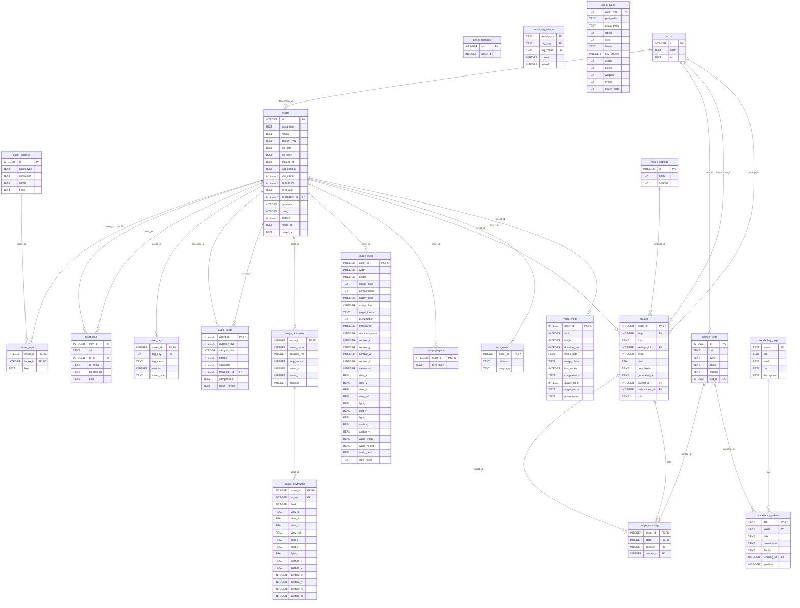

# DataDungeon's schema

*Generated by `scripts/schema_diagram.cr` from a fresh store (DataDungeon 0.15.0); don't edit by hand.*

Every table a store has, with its columns and the foreign keys it declares.
`asset_search` is SQLite's full-text index (FTS5), whose own tables are left out.

